<div align="center">

# 🛣️ XKeen Route

**Высокопроизводительная веб-панель раздельной маршрутизации, обхода DPI (Zapret 1 & 2), Smart Failover 2.0, AdGuard Home и управления прокси для роутеров Keenetic / Netcraze с XKeen (Mihomo / Xray).**

[](https://github.com/nickitafedorov2012-code/xkeen-ui-ext/releases)
[](LICENSE)
[-success.svg)](https://entware.net/)
[](https://keenetic.ru/)
[-DEA584?logo=rust)](backend/)
[](frontend/)

[🔥 Киллер-фичи](#-киллер-фичи-killer-features) • [📸 Обзор разделов и интерфейса](#-обзор-разделов-и-интерфейса) • [📋 Полный каталог возможностей](#-полный-каталог-всех-возможностей-системы-feature-catalog) • [⌨️ Горячие клавиши](#️-горячие-клавиши) • [⚡ Установка](#-быстрая-установка-entware) • [⚙️ Конфигурация](#️-конфигурация) • [🔧 Сборка](#-сборка-из-исходников)

</div>

---

## 🆕 Что нового в v1.10.1

Большой релиз надёжности по итогам полного аудита кода:

- 🛡️ **Безопасность**: закрыты выполнение чужих команд через настройки, DNS-rebinding и CSRF; секреты не уходят в настройки и бэкапы; бот слушается только владельца; AdGuard не виден из сети провайдера.
- 🌐 **Интернет и DNS не пропадают**: быстрый failover без ожидания уведомлений, точная проверка интернета, изолированный тест скорости, IPv6 не обходит белые списки, DNS AdGuard автоматически подстраховывается.
- 🚀 **Zapret**: правила перестраиваются при любом включении и выключении, системные DNS роутера больше не трогаются, правила брандмауэра не накапливаются.
- 💾 **Настройки не теряются**: надёжная запись и автоматическое восстановление конфигурации после сбоя питания; фоновые механизмы не перетирают ваш выбор; настройки устройства следуют за ним при смене IP.
- 📦 **Подписки**: рабочие Shadowsocks/VMess из v2ray-подписок, защита от «ломающих» символов, никакой самовольной смены формата.

Подробный список — в [DEVELOPMENT.md](DEVELOPMENT.md#v1101--большая-работа-над-надёжностью-интернет-и-dns-не-пропадают-настройки-не-теряются-безопасность-усилена), технический журнал исправлений с тестами — в [docs/FIX_LEDGER.md](docs/FIX_LEDGER.md).

---

## 📖 О проекте

**XKeen Route** — это современная модульная система управления маршрутизацией, обходом блокировок и инфраструктурой прокси для роутеров Keenetic и Netcraze под управлением среды **Entware**.

Она работает автономно в виде единого бинарного файла на **Rust** (Axum 0.8 + Tokio), потребляет всего **~6–12 МБ ОЗУ** и практически нулевую нагрузку на процессор, отдавая реактивный веб-интерфейс (React SPA + TailwindCSS) на порту `1001`.

---

## 🔥 Киллер-фичи (Killer Features)

1. 🧠 **Smart Failover 2.0 (Двухуровневое резервирование Tier 1 VPS vs Tier 2 Белые списки)**
   - **Разделение узлов по тирам**: стандартные зарубежные VPS (`Tier 1`) и отечественные узлы белых списков (`Tier 2`). Переход на Tier 2 осуществляется **только при падении всех VPS**.
   - **Ускоренный 60с Canary Soak Test**: при возврате связи с Tier 1 запускается изолированный тест через локальный листенер `127.0.0.1:7894` со сбросом сокетов.
   - **Защита от «зомби-серверов» (Persistent Quarantine)**: автоматическая отправка нестабильных нод в карантин с сохранением в `/opt/etc/xkeen-route/quarantine.json`.
   - **Детектор «черных дыр» (Blackhole anomaly)**: обнаружение узлов, которые принимают трафик (upload > 5 КБ), но не отдают ответ (download = 0 на $\ge 3$ сокетах).
   - **Честный учет трафика**: устранена подмена каналов — трафик белых списков и VPS считается строго раздельно.

2. ⚡ **Двухъядерный Zapret DPI (Zapret 1.x vs Zapret 2.0 nfqws2) + CDN Boost (`/boost`)**
   - Бесшовное переключение на лету между классическим `nfqws` и модульным `nfqws2`.
   - **Mini-Blockcheck**: встроенный тест блокировок с автоматическим подбором лучшей стратегии desync в 1 клик.
   - **CDN Boost (`/boost`)**: умное обнаружение и добавление скрытых поддоменов и CDN в хостлист.
   - **Индивидуальный Zapret (DPI) per-device**: включение/выключение обхода для каждого клиента отдельно прямо из таблицы устройств.
   - Независимые модули для YouTube 4K (кэши GGC на скорости провайдера), Discord (включая UDP Voice RTC), обхода блокировок и комьюнити-хостлистов.

3. 🛡️ **Белые списки (Whitelist Isolation Mode)**
   - Преодоление изоляции и блокировок зарубежного трафика.
   - Три стратегии: **Полный туннель** (Full Tunnel), **Прямой доступ к подсетям** (Subnet Direct) и **Привязанный шлюз** (Pinned Node).
   - Встроенный каталог отечественных сервисов (госуслуги, банки, маркетплейсы, CDN) и авто-детектор пригодности серверов.

4. 🛡️ **Встроенный AdGuard Home**
   - Интерактивный дашборд блокировок, Query Log в реальном времени, управление правилами и DNS Rewrites.
   - **Анти-петлевая защита портов**: перенос DNS-сервера AdGuard на порт `5354` для исключения конфликтов с Fake-IP ядра Mihomo (`53/udp`).

5. 📱 **Раздельная маршрутизация per-device & per-server**
   - Привязка любого домашнего устройства к персональному серверу, политике или прямому выходу (`DIRECT`).
   - Индивидуальные доменные правила и временные расписания активности клиентов.
   - Управление скоростью клиентов через Keenetic RCI API.

6. 🎮 **Игровой режим (Smart Gaming) и Xbox DNS**
   - Распознавание игровых сессий (CS2, Dota 2, Valorant, Apex Legends, Steam, PSN, Xbox).
   - Автоматическая генерация командного файла `fix_xbox_dns.cmd` для моментального устранения проблем со входом в службы Microsoft/Xbox Live.

7. 🩺 **Диспетчер задач (htop в вебе) и Swap Manager**
   - Встроенный монитор процессов роутера с сортировкой по CPU/RAM и кнопкой завершения зависших процессов (`kill`).
   - Создание и управление файлом подкачки (Swap) на USB-диске для предотвращения Out-Of-Memory на роутерах с 128/256 МБ RAM.

---

## 📸 Обзор разделов и интерфейса

### 📊 1. Дашборд (`Dashboard`)
Центральная панель мониторинга и мгновенного управления:
- **Метрики роутера**: загрузка CPU, температура процессора, RAM роутера и расход стека XKeen в целых числах.
- **Индикатор нехватки памяти**: адаптивный баннер `SwapRecommendationBanner` с предложением включить Swap в 1 клик при заполнении RAM.
- **Hero-карточка активного сервера**: бейдж статуса «🔵 В сети», протокол (VLESS, Shadowsocks и др.), текущий пинг и график RTT.
- **Модуль Smart Failover**:
  - Тумблер «🧠 Умный фейловер» (приоритет Tier 1 VPS перед Tier 2 БС).
  - Бейджи уровней серверов **Tier 1 (VPS)** и **Tier 2 (БС)**.
  - Честный объем трафика эпизодов белых списков без смешивания с основным прокси.
  - Журнал переключений с группировкой повторов (`×N`).
- **Спарклайн задержки (`PingSparkline`)**: компактная визуализация стабильности связи с миллисекундной точностью.
- **Быстрые действия**: экспресс-проверка доменов (`handleCheckDomain`), разблокировка в 1 клик и тумблер AdBlock.

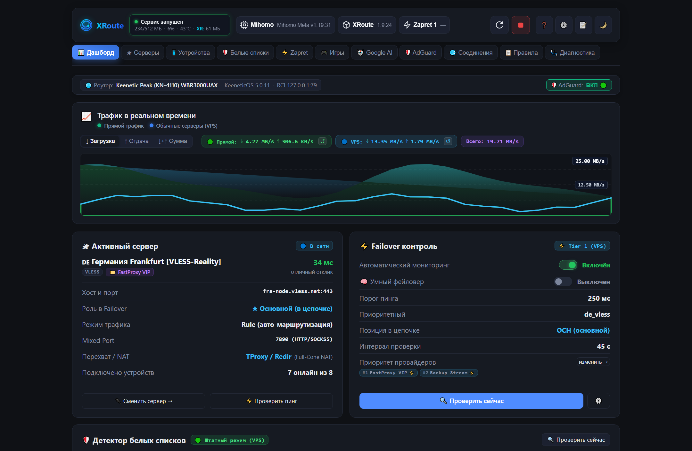

---

### 🛰 2. Серверы и подписки (`Servers`)
Управление каталогом прокси-узлов и источниками подписок:
- **Широкая поддержка протоколов**: VLESS Reality, VMess, Shadowsocks, Trojan, Hysteria2, TUIC, WireGuard.
- **Интерактивные замеры**: параллельный пинг всех узлов (`Ctrl + P`), замер джиттера в реальном времени (`measureLiveJitter`) и встроенный Speedtest.
- **Умное исправление названий (`fixNames`)**: автоматическое исправление кракозябр (mojibake cp1251/cp866) в именах нод.
- **Фильтрация и поиск**: мгновенный поиск (`Ctrl + K`), фильтры по странам, подпискам и тегам.
- **Шеринг и экспорт (`ShareNodeModal`)**: генерация QR-кодов без тяжелых внешних библиотек (собственный легковесный алгоритм Reed-Solomon) и экспорт ссылок.
- **Генератор Outbound (`OutboundGeneratorModal`)**: конвертация ссылок в готовый блок `outbounds` для ручной вставки в YAML.
- **Управление провайдерами**: добавление по URL/файлу, назначение алиасов, привязка HWID для защищенных подписок, контроль квот и ручное обновление.
- **Списки исключений (`openIgnore`)**: драфт-режим выбора узлов, исключаемых из ротации пула failover.

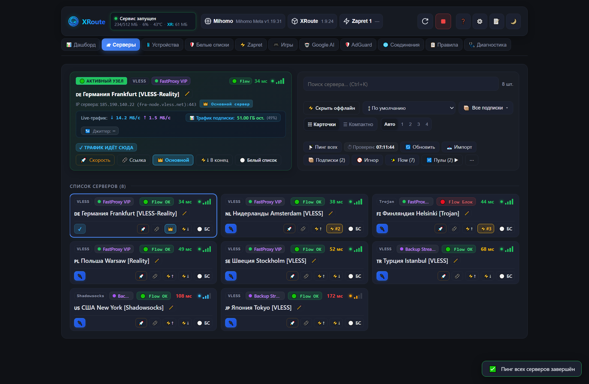

---

### 📱 3. Устройства и политики (`Devices` & `DeviceRow`)
Индивидуальный контроль клиентов локальной сети на базе DHCP Keenetic:
- **Таблица клиентов**: имя устройства, IP, MAC, тип линка (Wi-Fi 5GHz/2.4GHz/LAN), расход трафика и маркер активного пользователя «ВЫ».
- **Индивидуальный выбор сервера**: привязка конкретного устройства к любой ноде или прямому выходу (`DIRECT`).
- **Тумблеры режимов per-device**:
  - Независимый переключатель **Zapret (DPI)** для каждого клиента.
  - Индивидуальный тумблер **Игрового режима** (Gaming).
  - Тумблер включения режима **Белых списков** (Whitelist).
- **Ограничение скорости (`SpeedCell`)**: установка лимитов входящего и исходящего канала через Keenetic RCI API на лету.
- **Индивидуальные доменные правила (`DeviceRoutingModal`)**: переопределение маршрута для конкретных сайтов только на выбранном устройстве.
- **Планировщик расписаний (`DeviceScheduleModal`)**: включение и смена серверов по дням недели и часам.
- **Массовые операции**: групповое назначение политик, серверов и удаление настроек выделенных устройств.
- **Карта политик (`PoliciesMap`)**: наглядная визуализация привязки сетевых сегментов к интерфейсам.

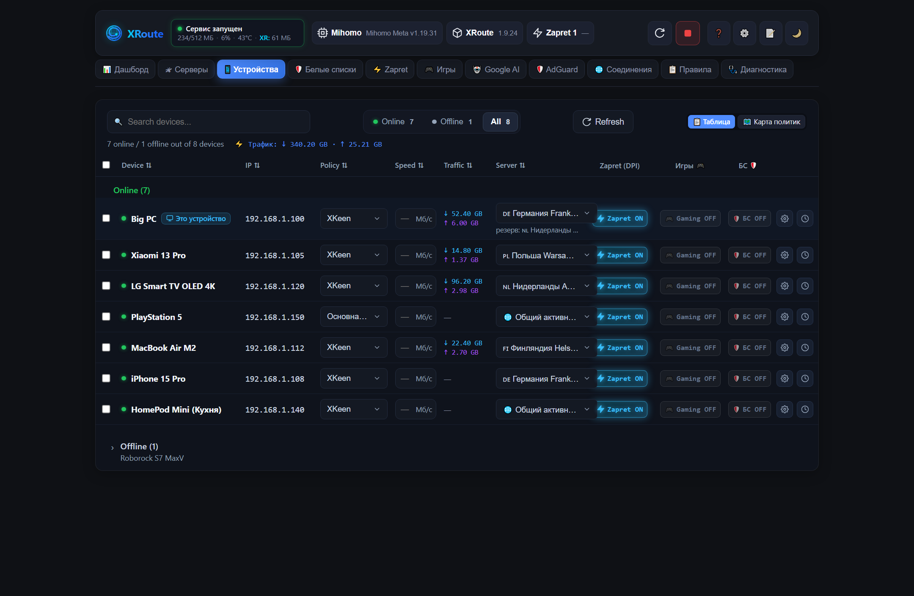

---

### 🛡️ 4. Белые списки (`Whitelist`)
Инструмент гарантированного обхода изоляции сетей:
- **Мастер-тумблер**: мгновенный перевод роутера в режим работы по белым спискам.
- **Выбор стратегии**:
  - *Full Tunnel*: перенаправление всего внешнего трафика через проверенные отечественные шлюзы.
  - *Subnet Direct*: сохранение прямого доступа к незаблокированным подсетям.
  - *Pinned Node*: жесткая фиксация выделенного сервера для белых списков.
- **Каталог сервисов**: встроенная база проверенных отечественных платформ, банков, госуслуг и CDN.
- **Автоматический детектор (`runWhitelistDetectorCheck`)**: проверка узлов пула на соответствие требованиям белых списков.
- **Пользовательские домены**: добавление и удаление персональных сайтов и IP-диапазонов.

---

### ⚡ 5. Zapret DPI и nfqws2 (`Zapret` & `ZapretCoreModal`)
Аппаратный обход деградации и замедлений без зарубежных VPS:
- **Переключатель ядер (Zapret 1.x vs Zapret 2.0)**: бесшовный переход между классическим `nfqws` и модульным `nfqws2`.
- **Подсказки по оборудованию**: автоопределение архитектуры CPU (ARM64, MIPS, MIPSle, x86) и объема RAM с предупреждением о совместимости.
- **Mini-Blockcheck**: встроенный алгоритм тестирования пакетов с авто-подбором лучшей стратегии десинхронизации в 1 клик.
- **Службы-модули**:
  - 🎥 *YouTube Turbo (Fake + Disorder2)*: просмотр 4K напрямую с кэшей GGC без нагрузки на VPS.
  - 💬 *Discord Web & Media (Fake + Split2)*: разблокировка чатов и картинок.
  - 🎙️ *Discord Voice RTC (UDP)*: перехват голосового пула портов для устранения ошибки «RTC Connecting».
  - 🌐 *Общий веб-обход (Hostlist)*: обход сайтов по списку `zapret-hosts.txt`.
- **CDN Boost (`/boost`)**: сканирование целевых ресурсов и автоматическое внесение всех связанных CDN-серверов в хостлист.
- **Синхронизация комьюнити-хостлистов**: автоматическое и ручное обновление баз заблокированных ресурсов.
- **6 готовых пресетов**: быстрая настройка под сценарии («Гейминг/Медиа», «Максимум ТСПУ», «Только YouTube»).
- **Аналитика перехвата**: счетчики перехваченных пакетов и сэкономленного трафика VPS.

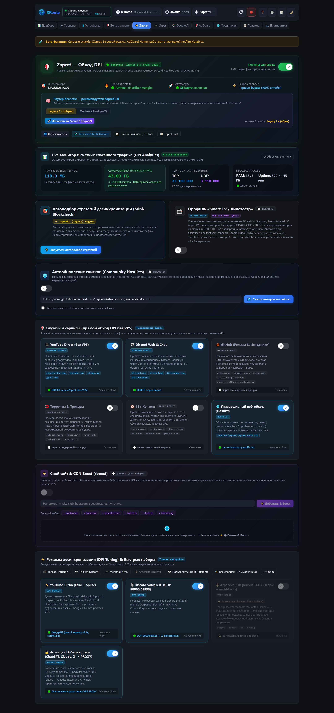

---

### 🎮 6. Игры и консоли (`Gaming` & `XboxDns`)
Специализированная среда для консолей и соревновательных ПК-игр:
- **Smart Gaming Mode**: авто-распознавание сетевого игрового трафика (CS2, Dota 2, Valorant, Apex, Steam, PSN, Xbox).
- **Настраиваемый тайм-аут**: удержание игрового маршрута в лобби и при поиске матчей без разрыва сессий.
- **Инспектор сокетов**: журнал UDP/TCP игровых сессий с кнопкой «Не реагировать» для отсечения фонового мусора.
- **Xbox Live & SmartDNS (`XboxDns`)**:
  - Тестирование подмены DNS для сервисов Microsoft и Xbox Network.
  - Генерация и скачивание готового файла `fix_xbox_dns.cmd` для быстрой настройки адаптеров ПК.
  - Пошаговые руководства по настройке для Xbox, PlayStation, ПК и самого Keenetic.

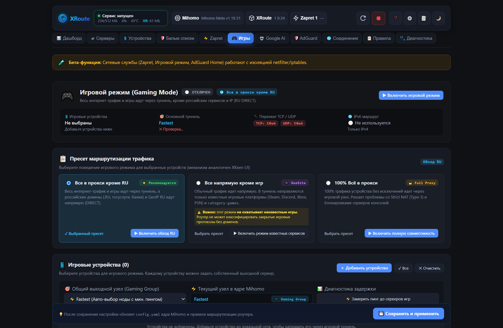

---

### 🤖 7. Google AI & Antigravity (`Antigravity` & `FlowRepairModal`)
Прозрачная среда для работы с LLM-сервисами:
- **Anycast & Geo Clean Check**: валидация чистоты IP и подтверждение географии узла для работы с Gemini API без ошибки `unsupported-country`.
- **Google Flow Unlocker**: интеграция и экспорт расширения Flow Unlock для браузера.
- **Автовыбор лучшего AI-узла**: автоматический переключатель на ноду с минимальным latency до инфраструктуры Google.
- **Встроенный локальный HTTP CONNECT прокси** (порт `53129`) для агентов разработки и CLI.

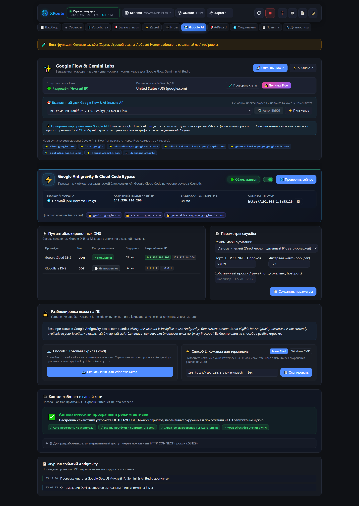

---

### 🛡️ 8. AdGuard Home (`AdGuard`)
Сетевая блокировка рекламы и трекеров без сторонних расширений:
- **Сводная статистика**: общее число DNS-запросов, заблокированные запросы и процент фильтрации.
- **Журнал DNS-запросов (Query Log)**: просмотр всех запросов клиентов сети с быстрой блокировкой домена в 1 клик.
- **DNS Rewrites**: создание и удаление собственных переопределений доменов.
- **Управление правилами фильтрации**: добавление списков EasyList, AdGuard Base и пользовательских правил.
- **Управление сервисом**: запуск, остановка и установка пакета AdGuard прямо из веб-интерфейса.
- **Безопасная интеграция**: защита от циклических DNS-запросов между AdGuard и Mihomo.

---

### 🌐 9. Активные соединения (`ConnectionsViewer`)
Глубокий мониторинг сетевой активности ядра в реальном времени:
- **Инспектор открытых сокетов**: отображение целевого хоста (с расшифровкой Fake-IP), клиентского IP, порта и процесса.
- **Скорость и объемы**: учет потребления трафика каждым отдельным соединением.
- **Управление в 1 клик**:
  - `Принудительный прокси`: мгновенное создание правила маршрутизации в прокси.
  - `Прямой доступ`: направление домена мимо прокси в прямое соединение (`DIRECT`).
  - `Закрыть все`: сброс всех открытых keep-alive сессий браузеров.

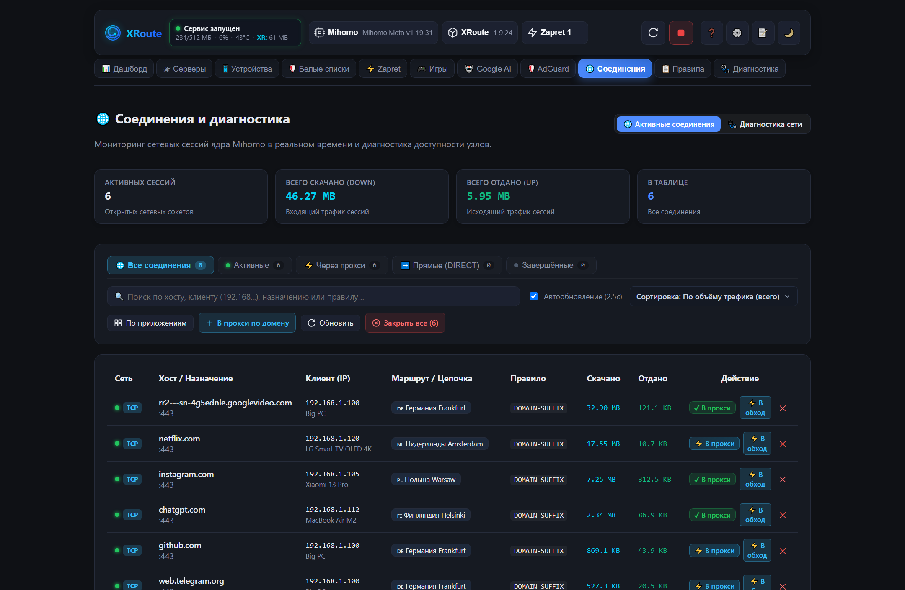

---

### 📋 10. Инспектор правил (`RulesViewer`)
Визуализация дерева маршрутизации Mihomo:
- **Интерактивный симулятор («Куда пойдет трафик?»)**: ввод домена или IP для проверки точного пути прохождения пакетов: `Клиент → Правило → Селектор → Нода`.
- **Каталог активных правил**: группировка по типам (`DOMAIN-SUFFIX`, `IP-CIDR`, `GEOIP`, `GEOSITE`, `MATCH`).

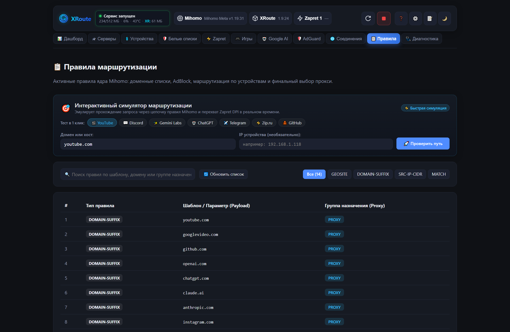

---

### 🩺 11. Диагностика и самовосстановление (`Diagnostics` & `SelfDiagnosticsCard`)
Комплексный инструмент аудита сетевого стека:
- **Автоматическое тестирование здоровья**: опрос доступности Keenetic RCI, ядра Mihomo, свободного места и RAM.
- **Анализ отравления DNS (DNS Poisoning)**: выявление подмены IP-адресов интернет-провайдером (РКН-заглушки) с раздельным тестом прямого и прокси-доступа.
- **Самовосстановление (`SelfDiagnosticsCard`)**: кнопки быстрого восстановления сетевых правил DNS в 1 клик (`adguard/sync-firewall`) и аварийного перезапуска ядра.

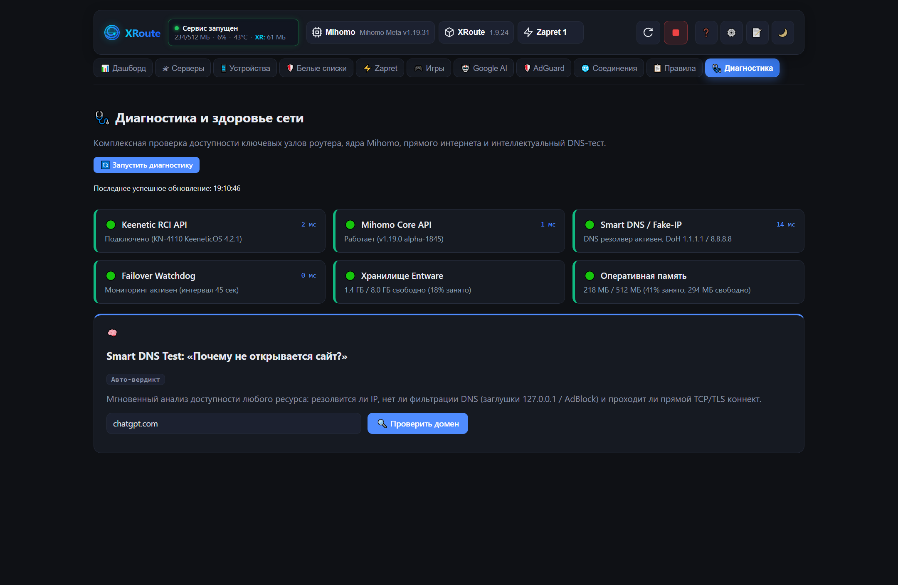

---

### ⚙️ 12. Настройки, Task Manager и Бэкапы (`Settings`, `TaskManager`, `ConfigEditor`)
Центр администрирования системы:
- **Диспетчер задач (`TaskManager` / htop в вебе)**: просмотр всех системных процессов роутера, сортировка по CPU% и RAM RSS с возможностью принудительного завершения зависших процессов (`kill`).
- **Swap Manager**: создание файла подкачки на USB-диске роутера, выбор объема и безопасное отключение.
- **Тонкая настройка Failover 2.0**: параметры гистерезиса, интервалы опроса, пороги пинга и список карантина серверов.
- **Бэкапы и восстановление**: экспорт полного снимка конфигураций в JSON, импорт и восстановление в 1 клик.
- **Telegram-уведомления**: оповещения в личный чат Telegram о переключениях Failover и перезапусках роутера.
- **Встроенный редактор файлов (`ConfigEditor`)**: просмотр и правка `config.yaml`, `xkeen-route.config.json`, `zapret.conf` и `hosts` прямо из браузера с валидацией синтаксиса.
- **Управление DNS-режимами**: переключение между `Fake-IP` и `Redir-Host`.

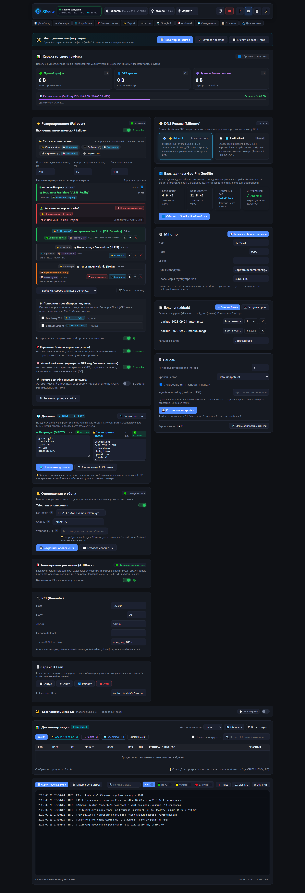

---

### 🔄 13. Модальные окна обновления (`UpdateModal` & `MihomoCoreModal`)
- **Обновление XKeen Route**: 1-клик проверка новых версий на GitHub, просмотр списка изменений и бесшовная установка бинарника.
- **Управление ядром Mihomo**: выбор и установка скомпилированных ядер под архитектуру процессора роутера.

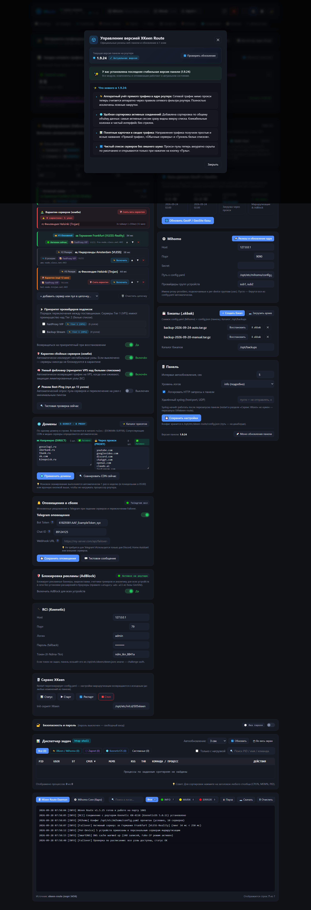

---

## 📋 Полный каталог всех возможностей системы (Feature Catalog)

| Модуль | Возможности и функционал |
| :--- | :--- |
| **Failover 2.0** | Двухуровневое разделение серверов (Tier 1 VPS vs Tier 2 Белые списки); 60с Canary Soak Test через локальный порт `7894`; Детектор аномалий «черная дыра» (upload > 5 КБ, download = 0); Защита от «зомби-серверов» с атомным сохранением в `quarantine.json`; Опрос пула с ограничением конкурентности; Адаптивный гистерезис переключения; Независимый failover per-device. |
| **Zapret DPI** | Двухъядерный переключатель Zapret 1.x / Zapret 2.0 (nfqws2); Индивидуальный тумблер DPI per-device; Встроенный Mini-Blockcheck с рекомендациями аргументов десинхронизации; Функция CDN Boost (`/boost`); Модули для YouTube 4K GGC, Discord Web и UDP Voice RTC; Авто-подсказки под процессор и память; Автоматическая синхронизация комьюнити-хостлистов. |
| **Белые списки** | Стратегии Full Tunnel, Subnet Direct и Pinned Node; Каталог отечественных сервисов, маркетплейсов и банков; Детектор пригодности серверов под белые списки; Честный раздельный учет трафика без подмены каналов. |
| **AdGuard Home** | Полный дашборд блокировок; Live Query Log; Управление DNS Rewrites и черными списками; Перенос порта на `5354` для предотвращения конфликтов и циклов с Mihomo. |
| **Маршрутизация** | Разделение клиентов домашней сети per-device & per-server; Индивидуальные доменные правила; Принудительный прокси (`AUTO-FORCE`); Ограничение скорости клиентов через Keenetic RCI; Расписание активности маршрутов (Device Schedule). |
| **Игры и SmartDNS** | Smart Gaming Mode с распознаванием портов CS2, Dota 2, Steam, Valorant, PSN, Xbox; Настраиваемый idle-таймаут; Инспектор игровых сокетов; Генератор `fix_xbox_dns.cmd` для консолей Xbox и ПК. |
| **Google AI** | Проверка Anycast Geo для исключения ошибок `unsupported-country`; Встроенный локальный прокси (`53129`); Автовыбор минимальной задержки до дата-центров Google; Экспорт расширения Flow Unlock. |
| **Инспекция** | Живой монитор открытых TCP/UDP сокетов; Сброс устаревших keep-alive сессий; Декодирование Fake-IP; Перенаправление сокетов в прокси/direct в 1 клик; Инспектор правил и симулятор прохождения трафика. |
| **Диагностика** | Аудит доступности компонентов; Выявление отравления DNS (DNS poisoning); Авто-восстановление правил DNS в 1 клик; Анализ сетевых интерфейсов Keenetic. |
| **Система и Swap** | Встроенный веб-диспетчер задач (htop) с возможностью `kill` процессов; Swap Manager для создания подкачки на накопителе роутера; Снимки и бэкапы конфигураций; Встроенный Web-Editor с синтаксической проверкой. |
| **Протоколы** | VLESS Reality, VMess, Shadowsocks, Trojan, Hysteria2, TUIC, WireGuard; Защита профилей через HWID; Авто-исправление кракозябр (cp1251/cp866). |

---

## ⌨️ Горячие клавиши

| Сочетание клавиш | Действие |
| :--- | :--- |
| **`Ctrl + K`** (или `Cmd + K`) | Открыть вкладку **Серверы** и сфокусироваться на строке поиска |
| **`Ctrl + P`** (или `Cmd + P`) | Запустить **параллельный замер пинга** всех доступных серверов |
| **`Ctrl + ,`** (или `Cmd + ,`) | Мгновенно перейти в **Настройки** панели |
| **`Alt + R`** (или `Shift + R`) | Принудительно **обновить данные** телеметрии и статус системы |
| **`Ctrl + S`** *(в редакторе конфигов)* | Проверить синтаксис и **сохранить файл** с hot-reload ядра |
| **`Ctrl + F`** *(в редакторе конфигов)* | Открыть панель **поиска по тексту** файла |

---

## ⚡ Быстрая установка (Entware)

Установка выполняется одной командой по SSH на роутере Keenetic/Netcraze с установленным Entware:

### Стабильная версия (Latest):

```sh
curl -Ls https://raw.githubusercontent.com/nickitafedorov2012-code/xkeen-ui-ext/main/setup.sh | sh
```

### Бета-версия (Beta):

```sh
curl -Ls https://raw.githubusercontent.com/nickitafedorov2012-code/xkeen-ui-ext/main/setup.sh | sh -s -- beta
```

> [!TIP]
> **Если `raw.githubusercontent.com` недоступен или заблокирован провайдером**, используйте зеркало:
> ```sh
> curl -Ls https://ghproxy.net/https://raw.githubusercontent.com/nickitafedorov2012-code/xkeen-ui-ext/main/setup.sh | sh
> ```

---

### 🕹 Управление сервисом

После установки панель доступна в браузере по адресу: **`http://<IP-роутера>:1001`** (например, `http://192.168.1.1:1001`).

Управление через системный init-скрипт Entware:
```sh
sh /opt/etc/init.d/S99xkeen-route start    # Запустить панель
sh /opt/etc/init.d/S99xkeen-route stop     # Остановить панель
sh /opt/etc/init.d/S99xkeen-route restart  # Перезапустить панель
sh /opt/etc/init.d/S99xkeen-route status   # Проверить статус процесса
```

---

### 🗑 Удаление

- **Удаление бинарника и службы (конфигурация сохраняется):**
  ```sh
  curl -Ls https://raw.githubusercontent.com/nickitafedorov2012-code/xkeen-ui-ext/main/setup.sh | sh -s -- uninstall
  ```
- **Полное удаление (вместе со всеми файлами конфигураций):**
  ```sh
  curl -Ls https://raw.githubusercontent.com/nickitafedorov2012-code/xkeen-ui-ext/main/setup.sh | sh -s -- uninstall purge
  ```

---

## ⚙️ Конфигурация

Файл конфигурации расположен по пути `/opt/etc/xkeen-route/config.json`. Поддерживается автоматический deep-merge (неуказанные параметры берутся из безопасных значений по умолчанию):

```json
{
  "rci": {
    "host": "127.0.0.1",
    "port": 79,
    "login": "admin",
    "password": "",
    "token": ""
  },
  "mihomo": {
    "host": "127.0.0.1",
    "port": 9090,
    "secret": "",
    "config_path": "/opt/etc/mihomo/config.yaml"
  },
  "failover": {
    "enabled": true,
    "smart_failover_enabled": true,
    "ping_threshold_ms": 250,
    "priority_server": "de_vless",
    "priority_chain": [
      "de_vless",
      "nl_vless",
      "fi_trojan"
    ],
    "auto_restore_priority": true,
    "interval_secs": 45,
    "device_failover_enabled": true
  },
  "zapret": {
    "enabled": true,
    "hybrid_youtube": true,
    "hybrid_discord": true,
    "discord_voice_udp": true,
    "youtube_turbo": true,
    "general_bypass": true,
    "aggressive_dpi": false,
    "isolated_proxy": true
  },
  "adguard": {
    "enabled": true,
    "host": "127.0.0.1",
    "http_port": 3000,
    "dns_port": 5354
  },
  "refresh_interval_sec": 5,
  "adblock_enabled": true
}
```

> [!NOTE]
> **Авторизация в Keenetic RCI**: панель автоматически считывает токен `X-Ndma-Tkn` из `/opt/etc/xkeen/xkeen.json`. При отсутствии токена используется встроенная challenge-response авторизация по логину и паролю администратора.

---

## 🔧 Сборка из исходников

### 1. Сборка фронтенда (Node.js 18+):
```sh
cd frontend
npm install
npm run build
```

### 2. Сборка бэкенда (Rust 1.75+):
```sh
cd backend
cargo build --release
```

### 3. Локальная разработка (с Hot-Reload):
```sh
# Терминал 1: Запуск бэкенда на порту 1001
cd backend && cargo run

# Терминал 2: Запуск дев-сервера Vite с автоматическим проксированием /api -> :1001
cd frontend && npm run dev
```

### 4. Кросс-компиляция под роутеры (MIPS / MIPSle / ARM64 / ARMv7):
Автоматически выполняется через [GitHub Actions](.github/workflows/build.yml) или локально с помощью [`cross`](https://github.com/cross-rs/cross):
```sh
cross build --target mipsel-unknown-linux-musl --release
cross build --target mips-unknown-linux-musl --release
cross build --target aarch64-unknown-linux-musl --release
cross build --target armv7-unknown-linux-musleabihf --release
```

---

## ⚠️ Безопасность

Панель **не требует обязательного пароля при входе из доверенной локальной сети (LAN)** для быстрого доступа домашних устройств.

> [!CAUTION]
> **Никогда не пробрасывайте порт `1001` в публичный интернет напрямую (через DMZ или проброс портов).**
> Для удаленного доступа извне используйте VPN-серверы роутера (WireGuard, OpenVPN, IPsec) либо службу KeenDNS с обязательной авторизацией по паролю KeeneticOS. При необходимости можно включить встроенную авторизацию по паролю в настройках панели.

---

## 🤝 Совместимость и благодарности

Проект развивается в тесной интеграции с экосистемой XKeen:
- [zxc-rv/XKeen-UI](https://github.com/zxc-rv/XKeen-UI) — базовые архитектурные идеи
- [Skrill0/XKeen](https://github.com/Skrill0/XKeen) и [jameszeroX/XKeen](https://github.com/jameszeroX/XKeen) — пакет XKeen для роутеров Keenetic
- [bol-van/zapret](https://github.com/bol-van/zapret) — технология автономного обхода DPI (nfqws / nfqws2)
- [Anonym-tsk/nfqws-keenetic](https://github.com/Anonym-tsk/nfqws-keenetic) — наработки запуска и интеграции nfqws в KeeneticOS

---

## 📄 Лицензия

Проект распространяется под свободной лицензией **GNU Affero General Public License v3.0 (AGPL-3.0)**. См. файл [LICENSE](LICENSE) для подробностей.

Copyright (C) 2026 nickitafedorov2012-code
