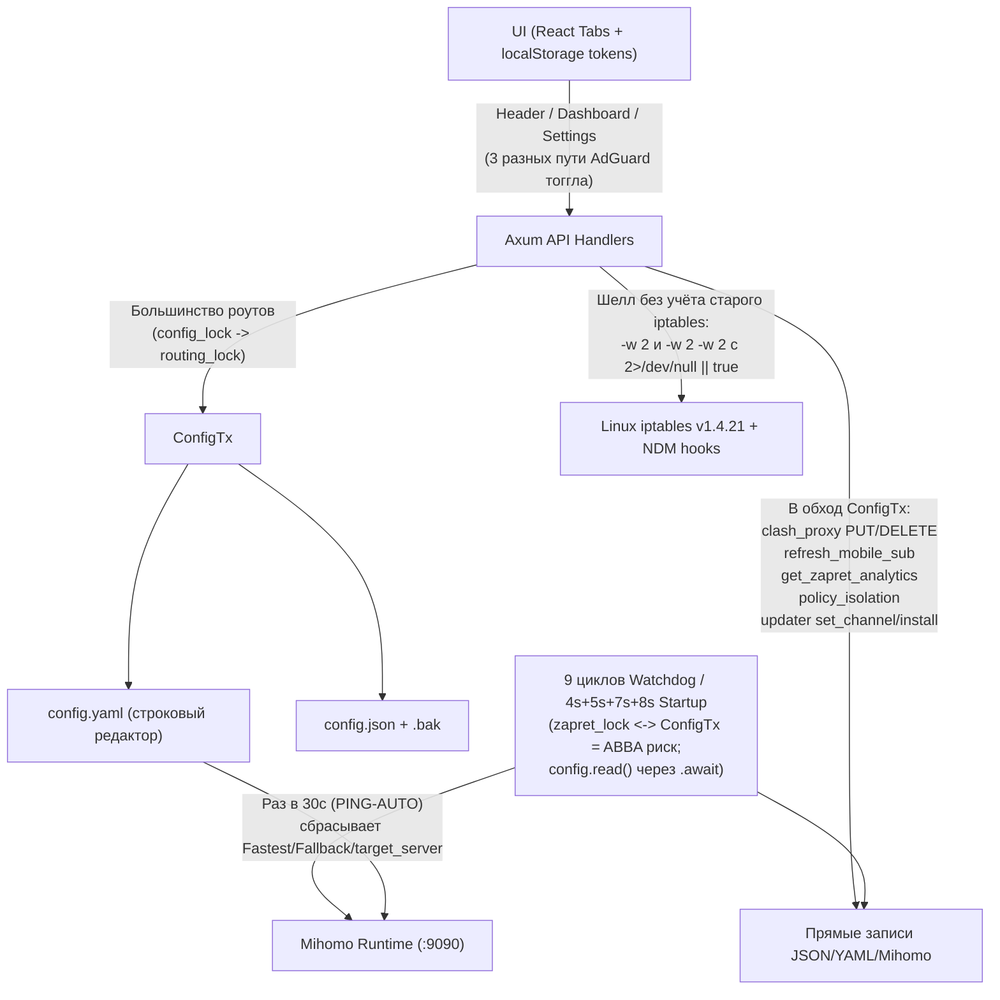

# Архитектурный анализ и причины «спагетти-кода» XKeen Route

**Репозиторий:** `c:\Users\internet\Desktop\xkeen route\xkeen-ui-ext-main` (`HEAD ac0368e`, `v1.17.0-beta.11`)  
**Объём кодовой базы (`scratch/synthesis_stats.json`):**
- **Backend (Rust):** `67` файлов, **`80,395` LOC**, из них **`32` файла ≥ 1,000 LOC**
- **Frontend (TS/TSX):** `129` файлов, **`49,639` LOC** (`83` production-файла = `37,138` LOC + `46` тест-файлов = `12,501` LOC)
- **CSS:** `12` файлов, **`8,681` LOC**
- **Итого проанализировано:** `138,715` LOC исходников + `.github/workflows/{build,ci,csqtt-core}.yml` + `setup.sh`

---

## 1. Системные причины превращения проекта в спагетти

По итогам 100% сплошного аудита (`B1..B6`, `F1..F3`) выделены **7 корневых архитектурных причин**, объясняющих появление сотен взаимосвязанных дефектов, регрессов и дублей:

1. **Незавершённое разрезание монолитов с перемешанными именами модулей.**  
   Исторические гиганты (`routing.rs`, `api.rs`, `failover.rs`) разрезались механически или в спешке, из-за чего в `backend/src/routing/*` имена модулей полностью не соответствуют содержимому (`[B4-001]`), а `mod.rs`-файлы хранят тысячи строк тестов вместо чистых фасадов.
2. **Мутация `config.yaml` и `AdGuardHome.yaml` строковым regex/построчным парсингом.**  
   Вместо единой структурированной модели (`serde_yaml` или единый AST/документный движок) 10+ функций в `routing/validator.rs`, `routing/ipset.rs`, `routing/iptables.rs`, `adguard/yaml.rs`, `free_sub/mod.rs` и `api/servers/mod.rs` редактируют YAML построчно с жёстким ожиданием 2-пробельных отступов и точных строк вроде `proxy-providers:`. Любое валидное отклонение (`proxy-providers: {}`, `proxies: [] # comment`, 4 пробела) либо создаёт дубли ключей, либо молча ничего не делает.
3. **Разрыв жизненного цикла сущностей (виртуальные пулы, БС/VPS, AdGuard, Zapret).**  
   Бесплатные подписки (`free_wl`/`free_vpn`) притворяются обычными нодами с `is_pool = false` (`mihomo.rs:1504-1547`), но при этом не существуют в селекторах Mihomo (`chains`, `/proxies`), заставляя `failover`, `whitelist-detector`, `speedtest`, `free_sub` и UI дублировать костыльные проверки и падать везде, где об этом исключении забыли.
4. **Несколько параллельных источников истины без единой конечной машины состояний.**  
   Состояние БС, гейминга, AdGuard и Zapret одновременно хранится в `config.json` (RAM + диск), `config.yaml` (Mihomo runtime), NDM/init-скриптах (`/opt/etc/ndm/netfilter.d/*`, `zapret.conf`, `S51zapret`), ядре Linux (`iptables`, `ipset`, `ip rule`) и `localStorage` браузера. При ошибке любого шага (откат Mihomo, недоступность RCI, отклонение `iptables -w 2` на Keenetic `v1.4.21`) предыдущие слои не откатываются.
5. **Нарушение границ слоёв и обход `ConfigTx` / иерархии локов.**  
   Низкоуровневый модуль `zapret.rs:679-703` вызывает `crate::api::should_use_nfqws2` / `build_nfqws2_args` (инверсия зависимостей `[B5-013]`); `clash_proxy.rs:12-62` пропускает `PUT`/`DELETE` прямо в Mihomo мимо `ConfigTx`; `failover/probe.rs:970-986`, `updater.rs:914-924, 1148-1156`, `api/zapret/diagnostics.rs:1190-1200` и `routing/policy_isolation.rs:279-304` пишут конфиги без полной пары `config_lock -> routing_lock`; а `watchdog.rs:1078` берёт `ConfigTx` внутри `zapret_lock` (риск ABBA-дедлока `[B3-010]`).
6. **Тотальное «проглатывание» ошибок shell/iptables и сетевых вызовов.**  
   В shell-скриптах (`040-adguard.sh`, `gaming.rs`, `zapret/firewall.rs`, `system_ssh.rs`) команды массово завершаются на `2>/dev/null || true`, а в Rust результаты игнорируются через `let _ = ...` (`adguard/mod.rs:641`, `adguard/service.rs`, `watchdog.rs:1253`, `mihomo.rs:1908`, `routing/iptables.rs`). В результате API возвращает `success: true`, а реальный фаервол остаётся пустым (подтверждено в живом тесте **T08b**).
7. **Ложно-зелёные тесты и маскировка падений в CI.**  
   `.github/workflows/ci.yml:55-63` запускает `cargo fmt --check || true`, `cargo clippy || true`, `cargo test --bin xkeen-route || true`. Набор тестов Rust (`799 passed`) и Vitest (`46 files, 386 tests`) включает тесты с переписанной прямо внутри теста логикой (`failover/mod.rs`, `traffic.rs`), самоматчащиеся `include_str!` (`backups.rs:608`), заглушку `#[cfg(not(target_os = "linux"))]` (`system.rs:815, 1075`) и фронтовые моки, скрывающие реальное поведение ядра и старого `iptables v1.4.21`.

---

## 2. Инвентарь монолитов и перекосов размеров

### 2.1. Backend Rust (`32` файла ≥ 1,000 LOC из `67`)

Топ-20 самых крупных модулей (`scratch/synthesis_stats.json`):

| # | Файл | Строк | Смешение зон ответственности / проблема |
|---|---|---:|---|
| 1 | `backend/src/failover/mod.rs` | `5,709` | Рабочая оркестрация `1..1346` + **`4,361` строк inline-тестов** (`76%` файла), ручной `best_ping`, failover устройств и smart restore (`[B3-002]`, `[B3-008]`) |
| 2 | `backend/src/mihomo.rs` | `4,713` | HTTP-клиент Clash API, кэш прокси, логика БС/VPS свитчинга (7 входов), 5 пингеров, `auto_heal`, `PING-AUTO`, Flow AI + тесты (`3261..4713`) |
| 3 | `backend/src/api/mod.rs` | `3,611` | Перегруженный barrel/utils + хендлеры статуса/логов + 1,300+ строк тестов и строковых grep-проверок (`regression_bug_70b` пропускает `-w 2`) |
| 4 | `backend/src/routing/mod.rs` | `3,380` | **99.4% тесты** (`21..3380`), всего 20 строк glue-кода (`[B4-001]`) |
| 5 | `backend/src/free_sub/mod.rs` | `3,064` | Источники, DNS/TCP/L7 пробинг, пул, кэш, автодобор, сторож зависаний, ручной YAML-парсер `parse_yaml_block` (`1036..1138`) + тесты (`2645..3064`) |
| 6 | `backend/src/watchdog.rs` | `3,013` | **9 разнородных демонов** без единого supervisor/shutdown-контракта (`1..1955`) + `1,057` строк тестов (`1956..3013`) |
| 7 | `backend/src/updater.rs` | `2,550` | Self-update панели + update guard (`ETXTBSY`, cron) + скачивание/инсталляция Mihomo (`mihomo_install`, RCE `[B1-001]`) + свой парсер `df` (`[B1-011]`) |
| 8 | `backend/src/config.rs` | `2,260` | Схема всех подсистем, дефолты с личным HWID (`geodema2`), миграции, sync `.bak`/`fsync`, `load()` lockout при пустом хеше (`[B1-005]`) |
| 9 | `backend/src/bot.rs` | `1,904` | Telegram long-poll loop, клавиатуры, отчёты, паника, домены, обновления без проверки shutdown/ошибок (`[B5-019]`, `[B5-021]`) |
| 10 | `backend/src/transaction.rs` | `1,897` | `ConfigTx`, 3-way merge, `commit-confirmed`, dry-run валидация YAML, несинхронный `Drop`-откат (`[B1-009]`) |
| 11 | `backend/src/system.rs` | `1,819` | `/proc` CPU/RAM (формула ×`num_cores` `[B1-014]`), два парсера `meminfo`, swap, порты, `df` |
| 12 | `backend/src/subscription_parser.rs` | `1,710` | Два параллельных конвертера подписок (`1159` vs `1277`), ручной YAML/URI/Xray JSON парсинг (`[B2-007]`) |
| 13 | `backend/src/api/system_ssh.rs` | `1,707` | Настройки, `xkeen_service`, `config-files`, swap, сброс настроек без `auth` (`[B1-006]`), `base64_encode`, парсинг `df` |
| 14 | `backend/src/vkturn/mod.rs` | `1,696` | Менеджер подписок `vkturn`, ссылки, маскирование токенов, конфиг `csqtt` |
| 15 | `backend/src/api/zapret/diagnostics.rs` | `1,674` | `install`/`upgrade`/фейковый `run_mini_blockcheck`/`analytics` без `config_lock` (`[B6-004]`..`[B6-006]`) |
| 16 | `backend/src/adguard/mod.rs` | `1,664` | HTTP-клиент AGH, свой `base64_encode`, свой `urlencoding_lite`, проверка доменов через `ends_with` (`[B5-006]`) |
| 17 | `backend/src/antigravity.rs` | `1,624` | Локальный HTTP/SOCKS5-прокси, DNS-парсер (`0xC0`), SmartDNS-пробер, мёртвая `diff_ip_host_rules` (`[B5-016]`..`[B5-018]`) |
| 18 | `backend/src/api/servers/mod.rs` | `1,569` | Переключение серверов, `ping`, `speedtest`, `import_node` (сырой YAML insert `[B2-006]`), `repair_flow` |
| 19 | `backend/src/api/zapret/presets.rs` | `1,542` | Пресеты, `zapret.conf` & `S51zapret` синк до `ConfigTx`, хардкод `MihomoConfig::default().config_path` (`[B6-011]`) |
| 20 | `backend/src/routing/dns_redirect.rs` | `1,513` | Неверно названный модуль с логикой Flow AI, AdBlock, Zapret Hybrid и Gaming (`[B4-001]`, `[B4-004]`, `[B4-006]`) |

*(Остальные 12 файлов >1,000 LOC: `api/routing/gaming.rs` `1475`, `traffic.rs` `1462`, `routing/validator.rs` `1347`, `failover/probe.rs` `1331`, `auth.rs` `1313`, `override_sync.rs` `1272`, `vkturn/tunnel.rs` `1231`, `zapret.rs` `1162`, `rci.rs` `1139`, `main.rs` `1069`, `api/zapret/firewall.rs` `1055`, `failover/scoring.rs` `1054`.)*

### 2.2. Frontend (`12` монолитов > 1,000 LOC + CSS `8,681` LOC)

| # | Компонент / Файл | Строк | Архитектурные симптомы |
|---|---|---:|---|
| 1 | `frontend/src/components/VkTurn.tsx` | `1,497` | Смешаны WS/polling, форма ссылок/OAuth, логи туннеля, `window.confirm()`, модалки |
| 2 | `frontend/src/components/Dashboard.tsx` | `1,454` | Смешаны статус, KPI, двойной тоггл AdGuard (`[F1-002]`), модалка ИИ-классификатора БС (дубль #1), хардкод порта `7890` (`[F1-004]`) |
| 3 | `frontend/src/components/AdGuard.tsx` | `1,431` | Статус, фильтры, query log, rewrites, конфиг, блокирующий `confirm()` (`[F3-008]`) |
| 4 | `frontend/src/components/ConnectionsViewer.tsx` | `1,369` | Таблица, фильтры, локальный `formatBytes`, `parseHostPort`, `confirm()`, прямой domain blocker |
| 5 | `frontend/src/components/Servers.tsx` | `1,359` | Оркестрация карточек, пулов `free_sub`, подписок, пингов, спидтестов, модалок (`[F2-002]` в `ServerList.tsx`) |
| 6 | `frontend/src/components/Whitelist.tsx` | `1,314` | Политики БС, каталог, устройства, 3-я копия модалки ИИ-классификатора (`[F2-009]`), мёртвый `setServersListUnused` |
| 7 | `frontend/src/components/Zapret.tsx` | `1,231` | Комбайн статуса, логов, пресетов и блокчека (`[F3-004]` в секциях) |
| 8 | `frontend/src/types.ts` | `1,228` | Единая монолитная простыня всех DTO панелей без разбиения по доменам |
| 9 | `frontend/src/components/settings/FailoverSection.tsx` | `1,220` | Цепочки VPS/БС, пресеты, карантин, канарейка и пул-контролы в одном файле (`[F1-006]`) |
| 10 | `frontend/src/components/Gaming.tsx` | `1,106` | Платформы, пинг, трафик, фейковый бейдж Open NAT (`[F2-003]`), свой `formatBytes` |
| 11 | `frontend/src/components/Antigravity.tsx` | `1,062` | Стейт прокси, домены, проверка доступности, события |
| 12 | `frontend/src/components/Devices.tsx` | `1,051` | Список устройств, политики, маршрутизация, английские строки в RU-UI (`[F2-008]`), `confirm()`, `formatBytes` |

*(Также близки к порогу `Settings.tsx` `991`, `TaskManager.tsx` `797`, `WhitelistDetectorSection.tsx` `712`.)*

---

## 3. «Перепутаница» подмодулей `backend/src/routing/*` (`[B4-001]`)

Вместо доменной декомпозиции разделение `routing.rs` привело к обмену именами и обязанностями:

| Файл | Что обещает имя | Что находится в файле на самом деле |
|---|---|---|
| `routing/validator.rs` (`1347` LOC) | Валидация маршрутов | **CRUD `proxy-providers` в `config.yaml`**: `parse_provider_names`, `add_provider_to_yaml_full`, `add_file_provider_to_yaml`, `delete_provider_from_yaml`, `sync_disabled_providers_in_yaml`, `update_provider_hwid_in_yaml` |
| `routing/policy_routing.rs` (`639` LOC) | PBR / `ip rule` маршрутизация | Генераторы **YAML-правил доменов и устройств**: `apply_domain_rules`, `apply_assignments`, `apply_ignore_to_groups` |
| `routing/ipset.rs` (`992` LOC) | Управление `ipset` | **0 вызовов `ipset`**; генерация правил БС и `Canary Probe`, парсинг `/proc/net/arp` |
| `routing/dns_redirect.rs` (`1513` LOC) | Настройка DNS redirect | Правила Mihomo для `Google AI`, `AdBlock`, `AdGuard upstream`, `Zapret Hybrid` и `Gaming` |
| `routing/iptables.rs` (`457` LOC) | Работа с `iptables` | Главный конвейер **`apply_routing_with_filters_and_default_ips`** и `sanitize_rule_targets` (реальные правила `iptables` разбросаны по `adguard/iptables.rs`, `vkturn/tunnel.rs`, `api/routing/gaming.rs`, `api/zapret/firewall.rs`, `api/system_ssh.rs`) |
| `routing/mod.rs` (`3380` LOC) | Координация routing | 20 строк `mod`/`pub use` + **3,360 строк inline-тестов** |

---

## 4. Рассинхронизация слоёв и сломанная иерархия блокировок

Ключевые узлы рассинхронизации (`[B1-008]`, `[B1-009]`, `[B2-008]`, `[B2-009]`, `[B3-003]`, `[B3-010]`, `[B4-006]`, `[B6-001]`, `[B6-002]`, `[B6-006]`):
1. **Порядок «мутировать до проверки / до коммита»:** `adblock_toggle_core`, `adguard_set_protection`, `commit_zapret_config_with_routing`, `zapret_set_enabled_core`, `failover/probe.rs` (установка `DETECTOR_STATE = Normal` до `switch_server`), `free_sub/mod.rs` (переключение `sync_mode_whitelist_state` до `switch_server` без отката) оставляют систему в полуприменённом состоянии при сбое шага #2.
2. **Удержание `RwLockReadGuard` (`state.config.read().await`) на сетевом и дисковом I/O:** обнаружено в `main.rs:532, 547, 737, 820`, `clash_proxy.rs:67-113, 147-603`, что парализует любые `config.write().await` при подвисании Mihomo или DNS.
3. **Запуск синхронных OS-команд на Tokio worker threads (`BUG-05` остаток):** `system.rs:1420, 1532` (`create_and_enable_swap`), `config.rs:1745, 1755` (`fsync`), `auth.rs:110-125, 157` (`revoke_token`), `api/status.rs:96, 219, 342`.
4. **Незащищённые HTTP-клиенты (`state.http`):** единый клиент в `main.rs:476-479` имеет `cookie_store(true)` (смешивает куки RCI, AdGuard, GitHub и спидтестов) и не задаёт общего таймаута (`T02` показал зависания `POST /api/providers/add` свыше 65–70с).

---

## 5. Влияние «спагетти» на качество тестов

| Категория дефекта тестов | Конкретные примеры из кодовой базы | Почему тест создаёт ложную уверенность |
|---|---|---|
| **Самоматчинг по исходнику (`include_str!`)** | `backups.rs:608` (`regression_r01_r02_r03_r06_backup_contracts`) | Срез `src[restore_start..]` включает сам модуль тестов и ищет строковый литерал из своего же `assert!`, хотя рабочий код уже переписан (`[B6-T01]`) |
| **Неполный статический grep** | `api/mod.rs:2233-2396` (`regression_bug_70b`) | Ищет отсутствие `-w` вообще, но не замечает несовместимый `-w 2` (вопреки комментарию на строке `1146`) и двойной `-w 2 -w 2` (`[B6-T02]`) |
| **Проверка локальной лямбды / копипаста логики вместо рабочего кода** | `updater.rs:2347` (`test_mihomo_custom_url_whitelist`), `traffic.rs:1078` (`test_traffic_honest_stream`), `failover/mod.rs:1614, 2335, 2478, 5211, 5231` | Рабочий код (`mihomo_install`, `sample_candidates` vs `scoring.rs`) ушёл вперёд или содержит обходы (`/../`, `req.sha256`), а тест проверяет вымышленную копию |
| **Платформенная заглушка + `|| true` в CI** | `system.rs:815, 1075-1078` + `.github/workflows/ci.yml:55-63` | На Windows `is_process_running("AdGuardHome")` захардкожен в `true`; на Linux тест падает, но `ci.yml` глушит выход через `|| true` (`[B1-007]`) |
| **Мёртвый тестируемый код** | `antigravity.rs:834-861, 1498-1527` (`diff_ip_host_rules`) | Функция тщательно протестирована, но в production `apply_keenetic_rules` (`587-626`) вообще не вызывается (`[B5-017]`) |
| **Устаревшие/личного стенда данные и глобальная порча состояния** | `failover/mod.rs:1711` (`SHUTDOWN`), `failover/mod.rs:2740` (`"geodema2": "keenetic-router-229"`) | Мутация глобального `SHUTDOWN` влияет на параллельные тесты, а личный провайдер зашит в дефолт и тест |
| **Фронтовые моки скрывают баги роутера** | `AdGuard.test.tsx:17, 62`, `Gaming.test.tsx:342`, `App.test.tsx` (16 `vi.mock`) | Мокают `dns_port: 53`, `tcp_interception: true` и вырезают детей — скрывают `avahi` `5353`, `-w 2`, `z-index: 1000` и MAC-only гейминг |
